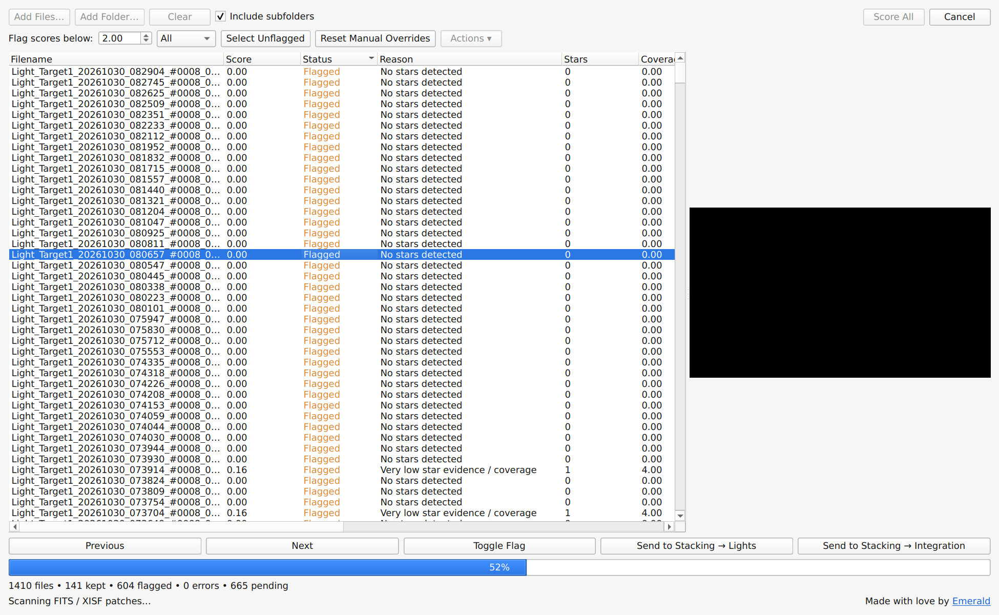

# Ultra Fast Blink

A quick way to weed out the worst frames from a long night of astrophotography, right inside Seti Astro Suite Pro!

I made this because of those nights that start out beautifully, only to turn cloudy or misty halfway through. You end up with a long stretch of photos, some good, some pretty much useless, and now you have to sort through all of them. I built and used Ultra Fast Blink for exactly this: finding the good photos in those long sessions and getting the obvious offenders out of the way.



## How does it work?

It reads the raw data directly. Think of opening a file with Notepad to look inside, except this tool understands the binary pixel data and processes small patches of it. It processes sampled patches to give you a first impression.

It looks for stars in patches spread across the image, then scores how much star evidence it finds and how widely it is spread. Previews are generated only when you select a frame.

**This is not a replacement for Blink in Seti Astro Suite Pro.** It operates on assumptions and sampled data, so the quality of its assessment and previews is lower than actual Blink. It can miss problems outside the sampled areas, and a low score isn't proof that a frame is bad. What it can do is weed out the worst offenders quickly. Use the real Blink for a proper look at what remains!

## What you get

- FITS and XISF screening, with folders and optional subfolders.
- Star counts, coverage, FWHM, eccentricity, background and noise measurements from sampled patches.
- A score threshold and manual flag overrides, so you stay in control.
- Previews on demand, with previous/next navigation.
- Send your selection to Stacking → Lights or Integration, when your SASpro version supports it.
- Rename, move and delete actions for sorting out your files. Deletion is permanent and asks for confirmation.

The score is a screening aid, not a stacking weight or a universal measure of image quality.

## Run it yourself!

1. Download this repository.
2. In SASpro, choose **Scripts → Open Scripts Folder**.
3. Copy **both** `ultra_fast_blink.py` and the entire `ultra_fast_blink` folder into that scripts folder, next to each other.
4. Choose **Scripts → Reload Scripts**.
5. Open **Scripts → Tools → Ultra Fast Blink Comparator**. You don't need an image open first.

Your scripts folder should look like this:

```text
scripts/
├── ultra_fast_blink.py
└── ultra_fast_blink/
    ├── __init__.py
    └── _*.py
```

Run it inside SASpro's Python environment, which needs NumPy, Astropy, SEP, PyQt6 and, for XISF files, the `xisf` library. This isn't a standalone command-line application.

## Sort out a night

Add your files or a folder, then click **Score All**. Start with the default threshold of 10 and look at a few previews to see whether it makes sense for your session. Adjust the threshold or toggle flags manually as needed.

Click **Select Unflagged** to select the keepers before sending them to stacking. The stacking buttons send selected rows, or all listed files if nothing is selected.

**Space** toggles flags. **Alt+Left** and **Alt+Right** move between frames.

## Supported formats

| Format | Supported? | Details |
| --- | --- | --- |
| Uncompressed FITS (`.fits`, `.fit`, `.fts`) | Yes | 2D images, at least 8 × 8 pixels. Reads mapped raw data and processes sampled patches without loading all pixels at once. |
| Compressed FITS | No | Decompress your files first. |
| Uncompressed XISF (`.xisf`) | Yes | Mono or RGB, at least 8 × 8 pixels. Uses the first image. Attached pixel data is mapped directly; inline data needs full decoding. Analysis still uses sampled patches. |
| Compressed XISF (`.xisf`) | Yes | Same image requirements as above. The image data needs full decompression into memory first, but the processing still happens in sampled patches. |

Missing your format? Feel free to open an issue to request it! Please include a demo file so I can see what we're working with.

Made with love by [Emerald](https://emerald.show) 💚
